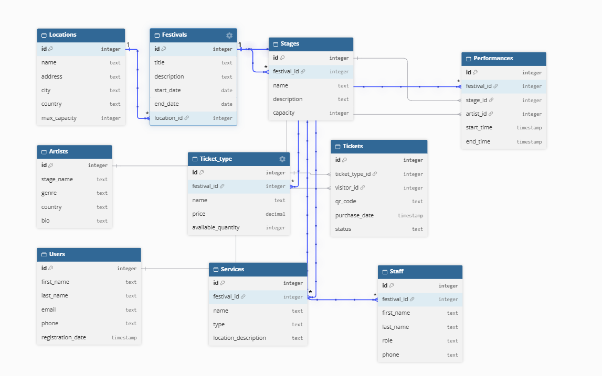

# Festivālu datubāze

## Projekta mērķis

Projekta mērķis ir izveidot programmu festivālu datu glabāšanai
un pārvaldīšanai.

Programmā var saglabāt informāciju par:

- festivāliem;
- festivālu norises vietām;
- skatuvēm;
- māksliniekiem;
- uzstāšanās reizēm;
- biļetēm;
- lietotājiem;
- pakalpojumiem;
- darbiniekiem.

## Izmantotās tehnoloģijas

Projektā izmantots:

- Python
- Tkinter
- SQLite
- sqlite3

Papildu bibliotēkas nav nepieciešams instalēt.

## Programmas funkcijas

Programmā iespējams:

- apskatīt tabulu datus;
- pievienot jaunus ierakstus;
- labot ierakstus;
- dzēst ierakstus;
- meklēt ierakstus;
- pārslēgties starp datubāzes tabulām.

## Datubāzes tabulas

Datubāzē ir tabulas:

- Locations
- Festivals
- Stages
- Artists
- Performances
- Ticket_type
- Tickets
- Users
- Services
- Staff

Tabulas ir savienotas ar primārajām un ārējām atslēgām.

Piemēram:

Festivals.location_id ir saistīts ar Locations.id.

Stages.festival_id ir saistīts ar Festivals.id.

Performances izmanto festival_id, stage_id un artist_id.

## Datubāzes ER diagramma

Datubāzes tabulu struktūra un to savstarpējās saites ir redzamas ER diagrammā:

Failam `erd.png` jāatrodas tajā pašā mapē, kur atrodas `README.md`.

## Projekta faili

main.py - programmas palaišana.

app.py - Tkinter grafiskā saskarne.

db.py - datubāzes un tabulu izveide.

functions.py - funkcijas darbam ar datiem.

terminal.py - programmas termināļa versija.

erd.png - datubāzes ER diagramma.

## Programmas palaišana

Visiem failiem jāatrodas vienā mapē.

Terminālī jāieraksta:

python main.py

Pirmajā programmas palaišanas reizē automātiski tiks izveidots
fails festivals.db.

## Kā jaunam lietotājam pieslēgties datubāzei

Lai palaistu projektu uz cita datora, nepieciešams:

1. Lejupielādēt projekta failus.
2. Pārliecināties, ka datorā ir instalēts Python.
3. Atvērt projekta mapi terminālī.
4. Palaist programmu ar komandu:

python main.py

Programma automātiski pieslēdzas SQLite datubāzei `festivals.db`.

Ja datubāzes fails vēl neeksistē, programma to izveido automātiski.

Ja tiek izmantots jau esošs `festivals.db` fails, tam jāatrodas tajā pašā
mapē, kur atrodas pārējie projekta faili.

SQLite datubāzei nav nepieciešams atsevišķs datubāzes lietotājvārds
vai parole.

Ja programmā nepieciešams pievienot jaunu lietotāju, to var izdarīt
cilnē `Users`, ievadot lietotāja datus un nospiežot pogu `Pievienot`.

## Datu saglabāšana

Visi programmas dati tiek glabāti SQLite datubāzes failā
festivals.db.

Dati saglabājas arī pēc programmas aizvēršanas.

## Ārējās atslēgas

Dažos laukos jāievada citas tabulas ieraksta ID.

Piemēram, ja Locations tabulā festivāla vietas ID ir 1,
tad Festivals tabulas laukā location_id jāievada 1.