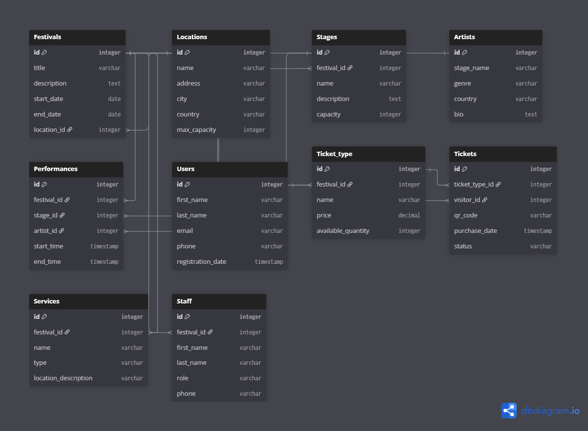

# datubaze
Datubāzē tiek glabāta informācija par festivāliem, māksliniekiem, lokācijām, biļetēm, skatuvēm utml.

# Mērķi
## 1. ER diagram

## 2. Izveidot 10 saistītas tabulas
## 3. Izveidot datubāzes struktūru ar SQL
